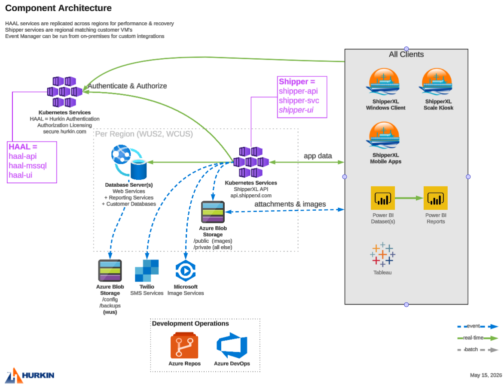

# Architecture

ShipperXL is built on Microsoft Azure. All components are built with Python, C#, SQL
or SSRS. The mobile apps are built with .NET MAUI.

- Customer data is kept in a separate database per customer, on regional shared
  servers. User sign-in and permissions (HAAL) are available globally.
- HAAL services are replicated across regions for performance and recovery. Shipper
  services are regional, matching the customers' VMs.
- Event Manager (the Job Agent) can run on premises for custom integrations.
- Mobile app builds are done by hand, with gated releases through the
  [Google Play Console](https://play.google.com/console) and
  [App Store Connect](https://appstoreconnect.apple.com). All other builds are
  automated.

