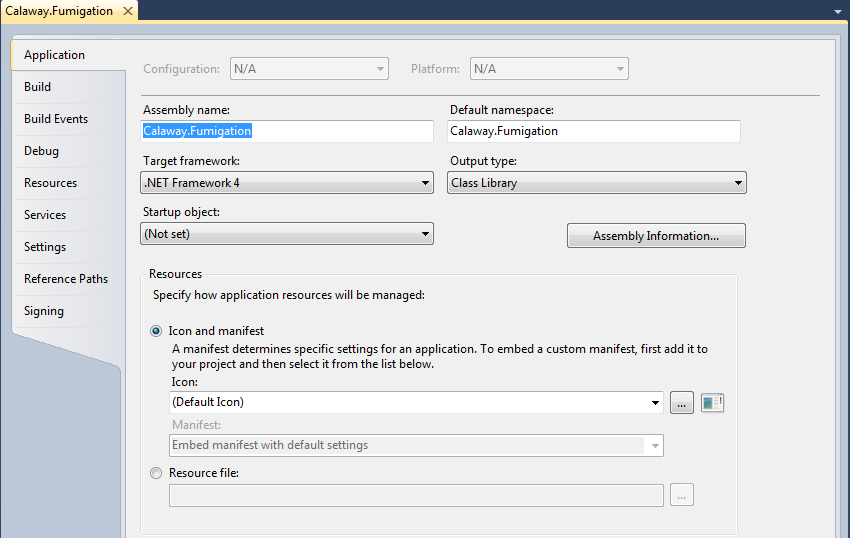
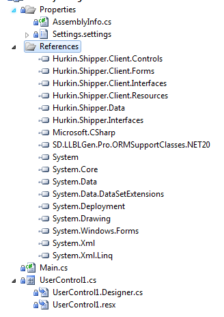
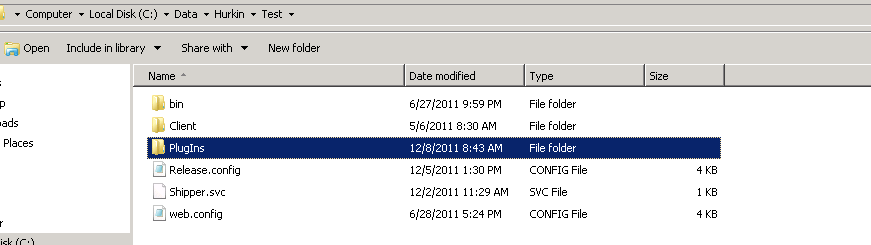

# Custom Plug-Ins

A plug-in adds your own screen to ShipperXL Desktop, under **Custom Items**. This
example is a fumigation tool that updates the copper plate, fumigated, opened and
ready-to-ship dates on many containers at once.

## Create the project

Create a new Visual Studio **Class Library** using .NET Framework 4.



## Add references

Add references to the Shipper client and data assemblies. Build their Release
versions from the latest source code.



## Main.cs

```csharp
using System;
using System.Collections.Generic;
using System.Text;
using Hurkin.Shipper.Client.Interfaces;
using System.Windows.Forms;

namespace Hurkin.Shipper.Client.Forms
{
    public class Main : Interfaces.IPlugIn
    {
        private IPlugInHost _host = null;
        private Control _control = null;

        public System.Windows.Forms.Control Initialize(IPlugInHost host)
        {
            _host = host;
            if (_control == null || _control.IsDisposed)
                _control = new Calaway.Fumigation.UserControl1(MenuItem);
            return _control;
        }

        public MenuItemInfo MenuItem
        {
            get
            {
                return new MenuItemInfo(String.Empty, "Fumigation Tool", EditLevel.Write, true);
            }
        }
    }
}
```

## Add a user control

```csharp
using System;
using System.Collections.Generic;
using System.ComponentModel;
using System.Drawing;
using System.Data;
using System.Linq;
using System.Text;
using System.Windows.Forms;
using Hurkin.Shipper.Client;
using Hurkin.Shipper.Client.Forms;
using Hurkin.Shipper.Data.EntityClasses;
using Hurkin.Shipper.Data.HelperClasses;
using Hurkin.Shipper.Data.TypedListClasses;
using SD.LLBLGen.Pro.ORMSupportClasses;

namespace Calaway.Fumigation
{
    public partial class UserControl1 : Hurkin.Shipper.Client.Forms.baseForm
    {
        public UserControl1(Hurkin.Shipper.Client.MenuItemInfo info)
        {
            InitializeComponent();
            InitializeBaseForm(info);

            colLocation.DataSource = Hurkin.Shipper.Client.Cache.GetItem(ItemType.LocationForCargo);
            colLocation.ValueMember = LocationFields.LocationId.Name;
            colLocation.DisplayMember = LocationFields.Description.Name;
        }

}
```

## Retrieving data

```csharp
private void ddlCargo_ValueChanged(object sender, EventArgs e)
{
    // If the Cargo Number changes, get existing values
    if (ddlCargo.Value.HasValue)
    {
        CargoEntity cargo = Program.Global.ShipperService.GetCargo(Program.Global.SessionId, ddlCargo.Value.Value) as CargoEntity;
        Program.Global.StopWaiting();

        ddlCargoLocation.Value = cargo.LocationId;
        if (cargo.PlannedAvailableToShip.HasValue)
            dtReadyToShip.DateTimeValue = cargo.PlannedAvailableToShip;

        if (cargo.CargoContainer != null)
        {
            txtCuPlate.Text = cargo.CargoContainer.CuPlate;
            if (cargo.CargoContainer.ActualFumigated.HasValue)
                dtFumigated.DateTimeValue = cargo.CargoContainer.ActualFumigated;
            if (cargo.CargoContainer.ActualOpened.HasValue)
                dtOpened.DateTimeValue = cargo.CargoContainer.ActualOpened;
        }
    }
}
```

## Saving data

```csharp
public override void SaveData()
{
    // A collection for saved records
    IEntityCollection2 toSave = new EntityCollection(new Hurkin.Shipper.Data.FactoryClasses.CargoEntityFactory());

    // Loop through the grid, retrieve rows, and add to collection
    foreach (DataGridViewRow row in grid.Rows)
    {
        int CargoId = (int)row.Cells[colCargoNumber.Index].Tag;
        string CuPlate = row.Cells[colCuPlate.Index].Value.ToString();
        int? LocationId = (int?)row.Cells[colLocation.Index].Tag;
        DateTime? Fumigated = (DateTime?)row.Cells[colFumigated.Index].Tag;
        DateTime? Opened = (DateTime?)row.Cells[colOpened.Index].Tag;
        DateTime? ReadyToShip = (DateTime?)row.Cells[colReadyToShip.Index].Tag;

        CargoEntity cargo = Program.Global.ShipperService.GetCargo(Program.Global.SessionId, CargoId) as CargoEntity;
        if (cargo != null && cargo.CargoContainer != null)
        {
            cargo.CargoContainer.CuPlate = CuPlate;
            cargo.CargoContainer.ActualFumigated = Fumigated;
            cargo.CargoContainer.ActualOpened = Opened;
            cargo.PlannedAvailableToShip = ReadyToShip;
            cargo.LocationId = LocationId;
            toSave.Add(cargo);
        }
    }

    // Perform Save
    Program.Global.ShipperService.SaveCollectionRecursive(Program.Global.SessionId, toSave, null);
    Program.Global.StopWaiting();
    grid.Rows.Clear();

    base.SaveData();
}
```

## Plugging it in

1. Turn on the Custom Forms (CFM) feature for a role in HAAL.
2. Put the DLL in the **PlugIns** folder on the server(s) that run the web services
   (`Shipper.svc`).



Clients check for plug-ins when users sign in, then download and add them. They
appear under **Custom Items**.
