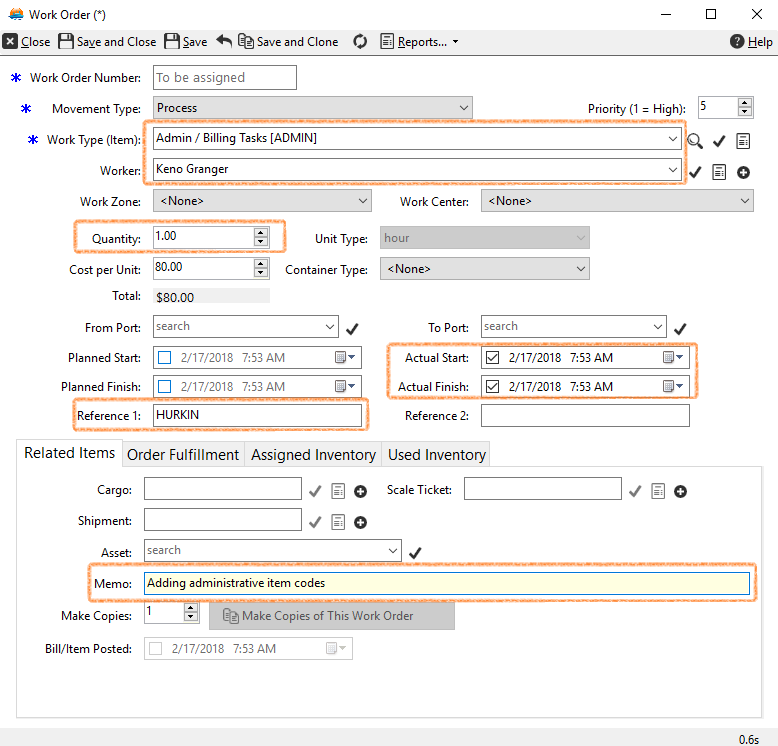

# Team Process

## Key points

- We run an [agile process](http://www.agilemanifesto.org/) and use many parts of the
  [Scrum framework](http://www.scrum.org/Portals/0/Documents/Scrum%20Guides/Scrum_Guide.pdf#zoom=100).
- No development work is done without a work item.
- Releases are Q1 (~March 31), Q2 (~July 4), Q3 (~October 31) and Q4 (~December 31).
  Releases are deployed to production within those windows, as needed.

## Types of work items

- A **Product Backlog Item** (PBI) is used for all development work we might do.
  - The title is `<Subject>: <Change>`, for example "Booking Report: Add Shipment
    Number".
  - The description needs enough specific information to do the work without a lot
    of back and forth.
- A **Bug** is any unexpected behavior. A bug must have detailed data and steps to
  reproduce it.

## Work item states

- **New:** needs review, and assigning for analysis or development.
- **Approved:** ready to be assigned to a release or iteration.
- **Committed:** part of a release or iteration.
- **Done:** completely tested and ready to deploy.

## Scenarios

- **New work item:** don't assign it to anyone. Set the Area. Leave Iteration as
  "Hurkin" (the default).
- **Prioritizing work:** drag and drop items in the
  [Product Backlog](https://github.com/orgs/hurkin/projects/1).
- **Completing work items:** check in the code and link it to the work item. Assign
  the PBI or bug to someone for testing.
- **Verifying work items:** set the status to Done. If there is a problem, leave the
  item in its state and reassign it.
- **Reopening work items:** only if the item is in the current iteration. Set the
  status back to New (or Active if New isn't available), and assign it back to
  whoever did the work.

## Recording work (time sheets): admin and support

All work is recorded as work orders in the HURKIN database:

- **Work Item Type:** ADMIN or SUPPORT
- **Worker:** your name
- **Quantity:** hours
- **Actual Start** and **Actual Finish**
- **Reference 1** (SUPPORT only): the database code of the customer to bill
- **Memo:** notes on what you did

A report runs automatically every week so these can be paid.



## Setting up a dev machine for windows development

1. Install VS Code, with the Python, C# and C# Dev Kit extensions.
2. Install Git.
3. Install the .NET 10.0 SDK and the .NET Framework 4.8 developer pack.
4. Install Visual Studio 20222025 Pro.
5. Clone the repos into `/local/git/hurkin`.
6. For the windows repos:
   ```sh
   dotnet workload restore
   dotnet workload update
   dotnet build ScaleClient.sln
   ```
7. Install [Chocolatey](https://chocolatey.org/install), then
   `choco upgrade wixtoolset -y`.
8. Open Visual Studio and install the WiX extension.
9. Build the release version of every solution.
